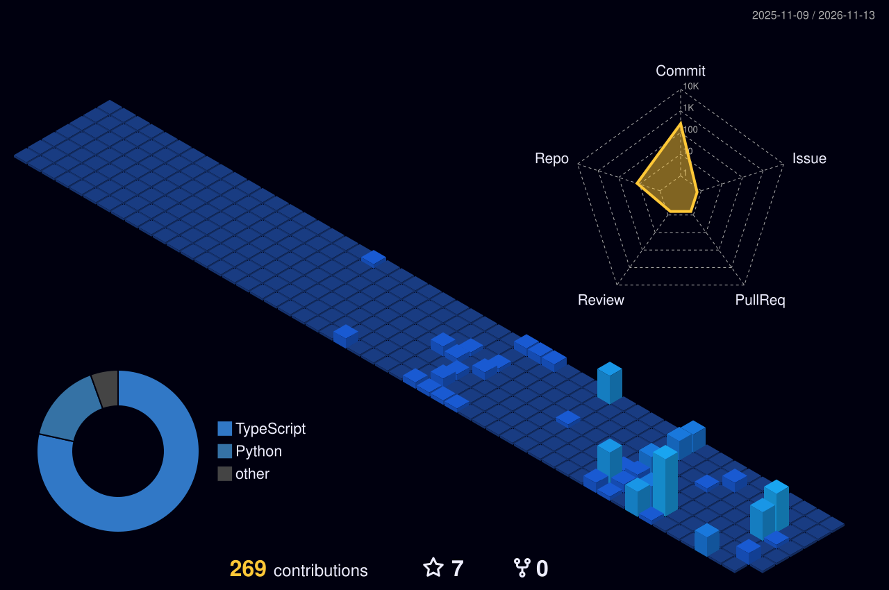

 

 

## 🚀 Featured Projects

| Project | What it is | Built with |
|:--|:--|:--|
| **[SaarthiX](https://github.com/avikanigam01/SaarthiX)** | AI-powered rural healthcare coordination platform: connects underserved communities with appropriate healthcare facilities, supports urgency-based patient routing and streamlines referrals. | React · TypeScript · Supabase · Tailwind CSS |
| **[Career Compass](https://github.com/avikanigam01/Career_Compass_WebApp)** | A career exploration app that helps users discover potential career paths. | Python · Streamlit |
| **[Hospital Triage](https://github.com/avikanigam01/AI-Hospital-Triage-Health-Assistant)** | A machine-learning project exploring patient triage and department prediction. | Python · Streamlit · Scikit-learn |
| **Mindful Password Generator** | A Python project focused on generating passwords with security in mind. | Python |
| **[More Projects →](https://github.com/avikanigam01?tab=repositories)** | Everything else I'm experimenting with. | Python · AI/ML |

 

 

[**GitHub**](https://github.com/avikanigam01) &nbsp;·&nbsp; [**LinkedIn**](https://www.linkedin.com/in/avika-nigam-1b443a381) &nbsp;·&nbsp; [**Email**](mailto:avikanigam01@gmail.com) &nbsp;·&nbsp; [**Instagram**](https://instagram.com/theavikanigam)

## 🏙️ Contribution City

*Curiosity starts it. Code builds it. Consistency grows it.*

